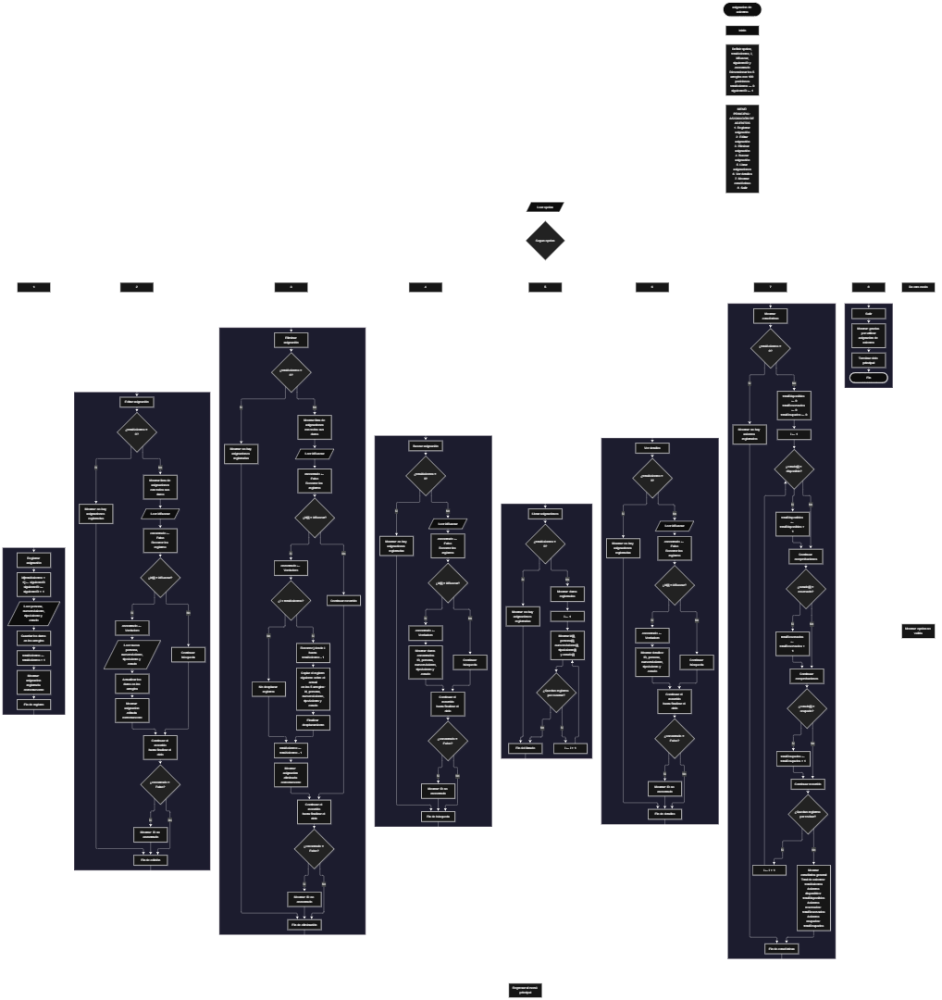

 

Este proyecto, llamado <b>asignación de asientos</b>, fue desarrollado en <b>pseint</b> como un ejercicio práctico para fortalecer la lógica de programación mediante la creación de un sistema de gestión de asignaciones desde la consola. El programa cuenta con un menú principal de ocho opciones que permite <b>registrar, editar, eliminar, buscar, listar, consultar los detalles y mostrar estadísticas</b> de las asignaciones registradas. Cada asignación almacena información como el nombre de la persona, el número del asiento, el tipo de asiento y su estado, utilizando arreglos con una capacidad declarada de <b>100 posiciones durante la ejecución</b>. Durante su desarrollo se aplicaron conceptos fundamentales de programación, como variables, arreglos, estructuras condicionales, ciclos repetitivos y estructuras de selección, además de procedimientos para buscar, modificar, eliminar y organizar registros. Este proyecto permite poner en práctica los conocimientos adquiridos en PSeInt y sirve como base para desarrollar sistemas de gestión más avanzados utilizando otros lenguajes y tecnologías.

<h2 align="center">⚙️ Funcionamiento del menú principal</h2>

### ➕ Registrar asignación

La opción <b>1) registrar asignación</b> permite agregar una nueva asignación de asiento al sistema. Para comenzar, el programa utiliza la variable <b>siguienteID</b> para generar un identificador único dentro de la secuencia de registros. El identificador se almacena en el arreglo <b>id</b>, en la posición correspondiente a <b>totalAsientos + 1</b>. Después, incrementa <b>siguienteID</b> y solicita los datos de la asignación: <b>nombre de la persona, número del asiento, tipo de asiento y estado</b>. La información se guarda en los arreglos <b>persona, numeroAsiento, tipoAsiento y estado</b>, utilizando la misma posición para relacionar los datos. Finalmente, el programa incrementa <b>totalAsientos</b> en uno y muestra el mensaje <b>"asignacion registrada correctamente."</b>. En el código actual no se comprueba si los arreglos han alcanzado su capacidad máxima ni se valida que los datos introducidos sean correctos.

### ✏️ Editar asignación

La opción <b>2) editar asignación</b> permite modificar los datos de una asignación existente. Primero, el programa comprueba si <b>totalAsientos</b> es igual a cero. Si no hay registros, muestra el mensaje <b>"no hay asignaciones registradas."</b>. En caso contrario, presenta una lista con el identificador, la persona, el número del asiento, el tipo de asiento y el estado de cada asignación. Después, solicita el identificador de la asignación que se desea editar y establece la variable lógica <b>encontrado</b> en <b>falso</b>. Mediante un ciclo <b>para</b>, recorre los registros y compara cada valor de <b>id[i]</b> con el identificador introducido. Si encuentra una coincidencia, cambia <b>encontrado</b> a <b>verdadero</b> y solicita los nuevos valores de la persona, el número del asiento, el tipo de asiento y el estado, actualizando los arreglos correspondientes. Finalmente, muestra el mensaje <b>"asignacion editada correctamente."</b>. Si el recorrido termina sin encontrar el identificador, presenta el mensaje <b>"no se encontró una asignacion con ese id."</b>.

### 🗑️ Eliminar asignación

La opción <b>3) eliminar asignación</b> permite eliminar un registro mediante su identificador. Antes de comenzar, el programa comprueba si existen asignaciones registradas. Si <b>totalAsientos</b> es igual a cero, muestra el mensaje <b>"no hay asignaciones registradas."</b>. Si existen registros, presenta una lista con los datos de las asignaciones y solicita el identificador que se desea eliminar. A continuación, inicializa la variable <b>encontrado</b> con el valor <b>falso</b> y recorre los registros mediante un ciclo <b>para</b>. Cuando encuentra el identificador, establece <b>encontrado</b> en <b>verdadero</b>. Si la posición seleccionada es anterior a la última posición ocupada, utiliza un ciclo controlado por la variable <b>j</b> para desplazar una posición hacia la izquierda los datos posteriores en los cinco arreglos: <b>id, persona, numeroAsiento, tipoAsiento y estado</b>. Después, disminuye <b>totalAsientos</b> en uno y muestra el mensaje <b>"asignacion eliminada correctamente."</b>. Si el identificador no existe, presenta el mensaje <b>"no se encontró una asignacion con ese id."</b>. El código actual no incluye una interrupción del ciclo después de eliminar un registro, por lo que el recorrido puede continuar con el total actualizado.

### 🔎 Buscar asignación

La opción <b>4) buscar asignación</b> permite localizar una asignación mediante su identificador. Primero, el programa comprueba si existen registros. Si no hay asignaciones almacenadas, muestra el mensaje <b>"no hay asignaciones registradas."</b>. En caso contrario, solicita el identificador que se desea buscar e inicializa la variable lógica <b>encontrado</b> con el valor <b>falso</b>. Después, utiliza un ciclo <b>para</b> para recorrer los registros y comparar el identificador introducido con los valores del arreglo <b>id</b>. Cuando encuentra una coincidencia, cambia la variable <b>encontrado</b> a <b>verdadero</b>, muestra el mensaje <b>"datos encontrados"</b> y presenta el identificador, el nombre de la persona, el número del asiento, el tipo de asiento y el estado. Si termina el recorrido sin encontrar coincidencias, muestra el mensaje <b>"no se encontró una asignacion con ese id."</b>. La búsqueda se realiza mediante el identificador de la asignación y no mediante el nombre de la persona o el número del asiento.

### 📋 Listar asignaciones

La opción <b>5) listar asignaciones</b> permite visualizar todas las asignaciones registradas en el sistema. Antes de mostrar los datos, el programa comprueba si <b>totalAsientos</b> es igual a cero. Si no existen registros, presenta el mensaje <b>"no hay asignaciones registradas."</b>. Si hay asignaciones disponibles, muestra el encabezado <b>"datos registrados"</b> y utiliza un ciclo <b>para</b> para recorrer los arreglos desde la primera posición hasta el total de registros almacenados. Durante el recorrido, presenta el identificador, la persona, el número del asiento, el tipo de asiento y el estado de cada asignación. Esta opción facilita consultar la información registrada sin necesidad de buscar cada asignación individualmente.

### 📄 Ver detalles de la asignación

La opción <b>6) ver detalles</b> permite consultar de manera individual toda la información de una asignación específica. Primero, el programa comprueba si existen registros mediante la variable <b>totalAsientos</b>. Si no hay asignaciones almacenadas, muestra el mensaje <b>"no hay asignaciones registradas."</b>. En caso contrario, solicita el identificador de la asignación que se desea consultar e inicializa la variable <b>encontrado</b> con el valor <b>falso</b>. A continuación, recorre el arreglo <b>id</b> mediante un ciclo <b>para</b> y compara cada identificador con el valor introducido. Si encuentra una coincidencia, cambia la variable a <b>verdadero</b> y presenta el encabezado <b>"detalles de la asignacion"</b>, seguido de los datos individuales: <b>id, persona, número del asiento, tipo de asiento y estado</b>. Si no encuentra el identificador, muestra el mensaje <b>"no se encontró una asignacion con ese id."</b>.

### 📊 Mostrar estadísticas

La opción <b>7) mostrar estadísticas</b> permite consultar un resumen de las asignaciones registradas según el estado de cada asiento. Primero, el programa comprueba si <b>totalAsientos</b> es igual a cero. Si no hay registros, muestra el mensaje <b>"no hay asientos registrados."</b>. Si existen asignaciones, inicializa los contadores <b>totalDisponibles, totalReservados y totalOcupados</b> en cero. Después, utiliza un ciclo <b>para</b> para recorrer las asignaciones almacenadas y comprobar el contenido del arreglo <b>estado</b>. Cuando encuentra un estado igual a <b>"disponible"</b>, incrementa <b>totalDisponibles</b>; cuando encuentra <b>"reservado"</b>, incrementa <b>totalReservados</b>; y cuando encuentra <b>"ocupado"</b>, incrementa <b>totalOcupados</b>. Finalmente, muestra el encabezado <b>"estadistica general"</b> y presenta el total de asientos, la cantidad de asientos disponibles, los reservados y los ocupados. Las estadísticas únicamente contabilizan los estados que coinciden exactamente con los valores comparados en el código.

### 🚪 Salir del menú principal

La opción <b>8) salir</b> permite finalizar la ejecución del programa y muestra el mensaje <b>"gracias por utilizar asignacion de asientos."</b>. El menú principal se encuentra dentro de una estructura repetitiva <b>repetir ... hasta que</b>, que mantiene el programa en funcionamiento mientras el usuario realiza las diferentes operaciones disponibles. La condición de salida es <b>hasta que opcion = 8</b>, por lo que, cuando se selecciona la opción 8, el ciclo termina después de ejecutar el mensaje de despedida. Si el usuario introduce una opción que no está contemplada en el menú, el bloque <b>de otro modo</b> muestra el mensaje <b>"opcion no valida."</b> y el programa continúa solicitando una opción mientras no se seleccione la salida.

<h2 align="center">🧠 Temas aplicados en el proyecto</h2>

### 📦 Variables

En este proyecto se utilizan variables para controlar la opción seleccionada en el menú, almacenar la cantidad de asignaciones registradas, generar identificadores, recorrer los arreglos, localizar registros y determinar si una asignación fue encontrada. También se utilizan variables para contar los asientos según sus estados. Cada variable cumple una función específica dentro de las operaciones de gestión de asignaciones.

🔢 **Opcion:** Almacena la opción seleccionada por el usuario en el menú principal.

📊 **TotalAsientos:** Almacena la cantidad actual de asignaciones registradas.

🆔 **SiguienteID:** Genera el identificador que se asignará al próximo registro.

🔎 **IDBuscar:** Almacena el identificador introducido por el usuario para localizar una asignación.

🔄 **I:** Funciona como contador en los ciclos `para` y permite recorrer las posiciones de los arreglos.

🔁 **J:** Controla el recorrido utilizado para desplazar los datos durante la eliminación de una asignación.

✅ **Encontrado:** Variable lógica que indica si se encontró una asignación con el identificador solicitado.

📊 **TotalDisponibles:** Cuenta las asignaciones cuyo estado es exactamente `"disponible"`.

📊 **TotalReservados:** Cuenta las asignaciones cuyo estado es exactamente `"reservado"`.

📊 **TotalOcupados:** Cuenta las asignaciones cuyo estado es exactamente `"ocupado"`.

### 🗃️ Arreglos

En este proyecto se utilizan cinco arreglos relacionados con la información de cada asignación. Cada arreglo tiene una capacidad declarada de <b>100 posiciones</b> y utiliza el mismo índice para representar los datos correspondientes a un mismo registro. Por ejemplo, la información de una asignación ubicada en la posición <b>1</b> se distribuye entre <b>id[1], persona[1], numeroAsiento[1], tipoAsiento[1] y estado[1]</b>. Esta organización permite recorrer, buscar, modificar, mostrar y eliminar registros de manera ordenada. La cantidad de posiciones que el programa considera ocupadas se controla mediante <b>totalAsientos</b>.

🆔 **Id[100]:** Almacena los identificadores de las asignaciones.

📝 **Persona[100]:** Almacena los nombres de las personas asociadas a cada asiento.

💺 **NumeroAsiento[100]:** Almacena los números de los asientos asignados.

🏷️ **TipoAsiento[100]:** Almacena el tipo de cada asiento.

📌 **Estado[100]:** Almacena el estado indicado para cada asignación.

### 🔀 Estructuras condicionales

En este proyecto se utilizan las estructuras <b>si</b> y <b>sino</b> para comprobar si existen asignaciones registradas antes de ejecutar las operaciones, determinar si un identificador coincide con algún registro, verificar si es necesario desplazar los datos durante la eliminación y clasificar los asientos según su estado. Las condiciones permiten que el programa responda de manera diferente según los datos almacenados y el resultado de cada comparación. También se utiliza la estructura condicional para comprobar si la opción seleccionada corresponde a la salida del menú o a una opción no contemplada.

### 🔄 Estructuras repetitivas

En este proyecto se utilizan los ciclos <b>para</b> y <b>repetir ... hasta que</b>. Los ciclos <b>para</b> permiten recorrer los arreglos para mostrar las asignaciones, localizar identificadores, modificar datos y calcular estadísticas. Durante la eliminación, un ciclo adicional controlado por <b>j</b> desplaza los registros posteriores hacia la izquierda. Por otro lado, el ciclo <b>repetir ... hasta que</b> mantiene activo el menú principal hasta que el usuario selecciona la opción <b>8</b>. Estas estructuras permiten ejecutar operaciones de manera organizada sin tener que escribir instrucciones individuales para cada registro.

### 🎯 Estructura según

El programa utiliza la estructura <b>según</b> para evaluar el valor almacenado en la variable <b>opcion</b> y ejecutar el bloque de instrucciones correspondiente. Cada caso representa una operación específica del sistema: <b>registrar, editar, eliminar, buscar, listar, ver detalles, mostrar estadísticas o salir</b>. Además, se utiliza el bloque <b>de otro modo</b> para mostrar el mensaje <b>"opcion no valida."</b> cuando el usuario introduce un número que no coincide con ninguna de las opciones definidas en el menú.

### 🔢 Dimensionamiento de arreglos

El programa utiliza la instrucción <b>dimension</b> para establecer 100 posiciones en cada uno de los cinco arreglos que almacenan la información de las asignaciones. La variable <b>totalAsientos</b> controla la cantidad de registros considerados activos y permite recorrer únicamente las posiciones comprendidas entre la primera y la última asignación registrada. Sin embargo, el código actual no incorpora una condición que impida registrar una nueva asignación cuando se alcanza la capacidad declarada de los arreglos.

### 🆔 Generación de identificadores

La generación de identificadores se realiza mediante la variable <b>siguienteID</b>, que comienza con el valor <b>1</b>. Al registrar una asignación, el programa almacena el identificador actual en el arreglo <b>id</b> y posteriormente incrementa la variable en uno. De esta manera, cada nuevo registro recibe el siguiente identificador de la secuencia. Cuando se elimina una asignación, el identificador de los registros restantes no se modifica durante el desplazamiento, y <b>siguienteID</b> no se reduce. Por tanto, el sistema continúa utilizando la secuencia de identificadores aunque se hayan eliminado registros anteriores.

### 🔄 Reorganización de registros

Cuando se elimina una asignación, el programa comprueba si la posición encontrada es anterior a la última posición ocupada mediante la condición <b>i &lt; totalAsientos</b>. Si se cumple, utiliza un ciclo <b>para</b> controlado por <b>j</b>, desde la posición que se desea eliminar hasta <b>totalAsientos - 1</b>. En cada repetición, copia los datos de la posición siguiente sobre la posición actual en los cinco arreglos: <b>id, persona, numeroAsiento, tipoAsiento y estado</b>. Después, disminuye <b>totalAsientos</b> en uno. Así, los registros posteriores se desplazan para ocupar la posición eliminada. En el código actual no se limpian expresamente los valores que quedan en la última posición después de la eliminación, ya que el programa deja de considerarla ocupada mediante el contador.

<h2 align="center">¿Cómo se implementaron las operaciones crud en el proyecto?</h2>

Las operaciones <b>crud</b> se implementaron mediante las opciones del menú principal, permitiendo administrar las asignaciones registradas. La operación <b>crear</b> corresponde a <b>registrar asignación</b>, donde se introducen los datos de una nueva asignación; <b>leer</b> se realiza mediante las opciones <b>buscar asignación, listar asignaciones y ver detalles</b>; <b>actualizar</b> corresponde a <b>editar asignación</b>, donde se modifican los datos de un registro existente; y <b>eliminar</b> se realiza mediante la opción <b>eliminar asignación</b>. Estas operaciones utilizan variables, arreglos, estructuras condicionales y ciclos repetitivos para gestionar la información almacenada durante la ejecución del programa.

<h2 align="center">Diagrama de flujo del proyecto</h2>

<h2 align="center">🛡️ Validaciones del programa</h2>

### 📭 No existen asignaciones registradas

Esta comprobación se utiliza en las opciones de <b>editar, eliminar, buscar, listar, ver detalles y mostrar estadísticas</b>. El programa verifica si la variable <b>totalAsientos</b> es igual a <b>0</b> y, cuando no existen registros, muestra un mensaje indicando que no hay asignaciones registradas o asientos registrados, según la operación seleccionada. Esta condición evita que dichas operaciones continúen intentando procesar registros cuando el contador indica que no hay asignaciones activas.

### ❌ Asignación no encontrada

Esta comprobación se utiliza en las operaciones de <b>editar, eliminar, buscar y ver detalles</b>. El programa inicializa la variable lógica <b>encontrado</b> con el valor <b>falso</b> y recorre el arreglo <b>id</b> para comparar cada identificador con el valor introducido por el usuario. Cuando encuentra una coincidencia, cambia <b>encontrado</b> a <b>verdadero</b> y ejecuta la operación correspondiente. Si el recorrido finaliza sin encontrar el identificador, muestra el mensaje <b>"no se encontró una asignacion con ese id."</b>. Esta comprobación permite informar al usuario cuando el identificador solicitado no corresponde a una asignación registrada.

### 📌 Clasificación de los estados

La opción de estadísticas compara cada valor del arreglo <b>estado</b> con las cadenas <b>"disponible"</b>, <b>"reservado"</b> y <b>"ocupado"</b>. Cada coincidencia incrementa el contador correspondiente. Sin embargo, durante el registro, el mensaje solicita introducir el estado con la indicación <b>"ocupado/disponible"</b>, mientras que las estadísticas también consideran el estado <b>"reservado"</b>. El programa no valida que el usuario introduzca únicamente estos valores ni normaliza mayúsculas, minúsculas o espacios. Por ello, los estados que no coincidan exactamente con las cadenas comparadas no se suman a ninguno de los tres contadores.

### ⚠️ Capacidad de los arreglos

Los cinco arreglos tienen una capacidad declarada de <b>100 posiciones</b>. No obstante, la opción de registro no comprueba si <b>totalAsientos</b> ha alcanzado esa cantidad antes de almacenar una nueva asignación. En consecuencia, el programa no incluye una validación explícita para impedir registros que superen la capacidad definida. Esta limitación corresponde al código actual y se documenta para distinguir la capacidad declarada de los controles que realmente se han implementado.

### ⚠️ Opción inválida

La estructura <b>según</b> incluye el bloque <b>de otro modo</b>, que muestra el mensaje <b>"opcion no valida."</b> cuando el usuario introduce una opción distinta de los valores contemplados en el menú. Después de mostrar el mensaje, el ciclo repetitivo vuelve a presentar el menú principal, siempre que no se haya seleccionado la opción <b>8</b>, que corresponde a salir del programa.

<h2 align="center">🎯 Objetivo del proyecto</h2>

El objetivo principal de este proyecto es fortalecer la <b>lógica de programación</b> mediante el desarrollo de un sistema de gestión de asignaciones de asientos en <b>pseint</b>. A través de su construcción se busca aplicar los conocimientos adquiridos sobre variables, arreglos, estructuras condicionales, ciclos repetitivos y estructuras de selección, integrándolos para resolver un problema de manera organizada. Además, el proyecto permite comprender cómo registrar, consultar, modificar y eliminar información, generar identificadores, reorganizar registros y obtener estadísticas mediante una aplicación de consola. De esta forma, se establece una base para desarrollar sistemas de gestión más completos utilizando otros lenguajes y tecnologías.

